# ESFOCAR Estudio

**App de estudio, repaso, autoevaluación y análisis de casos para estudiantes en formación de la Escuela de Formación de Carabineros (ESFOCAR).**

| | |
|---|---|
| Asignatura | DSY1105 Desarrollo de Aplicaciones Móviles – EP3 |
| Caso | 004D · *Repaso, autoevaluación y análisis de casos aplicados para estudiantes en formación* |
| Integrantes | Maximiliano Rodriguez |
| Planificación | Tablero Trello: [https://trello.com/invite/b/6ac5334d9b310ede4021076e/ATTIce29801360203fde28c5ceb5dc4837d7B46501CB/maximiliano-rodriguez]|
| Versión | 2.0 (`versionCode 2`) |

> Todo el contenido (normas, protocolos, preguntas y casos) es **ficticio y de uso académico**. No se usan datos personales reales ni se conecta a sistemas institucionales.

---

## 1. Problema y propuesta

Los estudiantes en formación repasan con material estático (apuntes, documentos, presentaciones), sin ejercicios interactivos ni retroalimentación inmediata. Además, parte del estudio ocurre en terreno, con **conectividad limitada o nula**.

**ESFOCAR Estudio** es una herramienta complementaria que funciona **sin internet desde el primer uso** y permite:

| Necesidad del caso (3.1) | Cómo la resuelve la app |
|---|---|
| Estudiar normativa y contenidos por unidad o asignatura | Asignaturas → unidades → **fichas de estudio** con puntos clave, búsqueda y fichas guardadas |
| Repasar procedimientos con preguntas o trivias | **Trivia por unidad, por asignatura y trivia rápida**, con retroalimentación inmediata y explicación |
| Prepararse para evaluaciones | **Simulacro con tiempo y nota 1.0–7.0** (60 % de exigencia) y revisión de errores al final |
| Analizar situaciones simuladas y elegir cómo actuar | **Casos simulados**: actuación óptima / aceptable / incorrecta, con fundamento |
| Resolver ejercicios y casos planteados por docentes | **Modo docente**: el docente publica, edita y elimina preguntas y casos desde la app; llegan a los estudiantes al sincronizar |
| Recibir retroalimentación inmediata | Colores, vibración, explicación por pregunta y por opción de actuación |
| Revisar resultados y avance | Racha de estudio, promedio, dominio por asignatura, temas débiles, **repaso de errores** e historial |

## 2. Funcionalidades

**Estudio**
- Bienvenida (onboarding) y pantalla de inicio (splash) con el emblema institucional.
- Registro e inicio de sesión con validación por campo; la sesión se recuerda.
- 4 asignaturas, 9 unidades, 18 fichas de estudio, 45 preguntas y 12 casos simulados.
- Búsqueda en las fichas y marcadores para guardarlas.

**Autoevaluación**
- Trivia por unidad, por asignatura o rápida (10 preguntas al azar). Las preguntas y alternativas se mezclan en cada intento.
- Simulacro de evaluación: 15 preguntas, 10 minutos, nota con escala chilena y resultado aprobado o reprobado.
- Repaso de errores: reúne las preguntas cuya última respuesta fue incorrecta y las quita al responderlas bien.
- Casos simulados con filtros por dificultad y por pendientes, más un caso del día en el inicio.

**Progreso**
- Panel con racha de días, promedio, mejor nota, casos resueltos y un gráfico de actividad de los últimos 7 días.
- Dominio por asignatura y temas para reforzar (unidades con menos de 60 % de acierto).
- Resumen que calcula el servidor e historial con el estado de sincronización de cada actividad.

**Modo docente**
- Registro como docente con un código institucional. En este MVP el código es ficticio: `DOCENTE-ESFOCAR`.
- Panel docente: se elige asignatura y unidad, y se listan sus preguntas y casos.
- Formularios para crear y editar:
  - **Preguntas**: enunciado, explicación y de 2 a 5 alternativas, cada una con su retroalimentación. Se marca la correcta.
  - **Casos simulados**: situación, pregunta, dificultad, fundamento y de 2 a 5 opciones calificadas como óptima, aceptable o incorrecta.
- Eliminar pide confirmación.
- Lo publicado se guarda en `ms-contenidos`, sube la versión del contenido y las apps de los estudiantes lo descargan al sincronizar.
- Validación en el formulario con las mismas reglas del servidor. Publicar requiere conexión; si no hay, se avisa con un mensaje claro.

**Herramientas**
- Apuntes personales (CRUD) que funcionan sin conexión y se sincronizan al recuperarla.
- Documentos PDF y Word guardados en el teléfono.
- Explorar conceptos con Wikipedia (API externa).
- Recordatorio por notificación.
- Tema claro, oscuro o el del sistema.
- Sincronización manual y automática con WorkManager.

## 3. Arquitectura

```
┌───────────────────────────── App Android (Kotlin · Jetpack Compose · Material 3) ─────────────────────────────┐
│  ui/ (pantallas)  →  viewmodel/ (estado y lógica, MVVM)  →  data/ (repositorios)                               │
│                                                              │                                                 │
│                                       ┌──────────────────────┴───────────────────────┐                         │
│                                       ▼                                              ▼                         │
│                         Room / SQLite (fuente de verdad local)         Retrofit + OkHttp                       │
│                         contenido · progreso · apuntes · favoritos      │                                      │
│                                       ▲                                 ├─► ms-contenidos  :8083 (H2)          │
│                  WorkManager (sincroniza al haber internet) ────────────├─► ms-apuntes     :8081 (H2)          │
│                                                                         ├─► ms-resultados  :8082 (H2)          │
│                                                                         └─► Wikipedia REST (API externa)       │
└────────────────────────────────────────────────────────────────────────────────────────────────────────────────┘
```

### Offline-first (requisito 5.1 del caso)
1. **La app siempre lee desde Room**, así que estudiar y autoevaluarse nunca depende de la red.
2. En el primer uso, Room se llena con `assets/contenido_inicial.json`, que es el **mismo archivo** que usa `ms-contenidos` como semilla. La app funciona aunque nunca haya tenido internet.
3. Con conexión, la app consulta `GET /api/contenidos/version`. Si la versión del servidor es distinta de la local (por ejemplo, porque un docente publicó cambios), descarga el paquete completo y lo reemplaza en una sola transacción.
4. Los apuntes y resultados se guardan al instante en el teléfono con estado *pendiente*. **WorkManager** los sube a los microservicios cuando hay red, aunque la app esté cerrada.
5. Si un apunte editado fue borrado en el servidor, se vuelve a crear para no perder la edición. Si se borró desde otro dispositivo, desaparece del teléfono.

```
app/src/main/java/com/example/esfocarapp/
├── data/          ContenidoRepository, ProgresoRepository, ApuntesRepository, Sincronizador (+WorkManager)
│   ├── local/     Room: entidades, DAOs, AppDatabase (v4)
│   └── remote/    Retrofit: APIs, DTOs, manejo de errores (Respuesta)
├── model/         Modelos del dominio y reglas puras: nota, racha, dominio, caso del día
├── viewmodel/     Auth, Estudio, Quiz, Caso, Progreso, Apuntes, Ajustes, Documentos, Conceptos + Fabrica
├── ui/            Pantallas Compose y sistema de componentes (ui/components) y tema (ui/theme)
└── util/          Validaciones, seguridad, preferencias, conexión, vibración, notificaciones
backend/           Microservicios Spring Boot 3 (Java 17): ms-contenidos, ms-apuntes, ms-resultados
release/           APK y App Bundle (AAB) firmados
docs/              Capturas y verificación de firma
```

## 4. Endpoints

### 4.1 `ms-contenidos` (puerto 8083): contenido académico
| Método | Ruta | Uso |
|---|---|---|
| GET | `/api/contenidos/version` | Versión actual del contenido (la app la compara con la suya) |
| GET | `/api/contenidos/paquete` | Todo el contenido: asignaturas → unidades → fichas, preguntas y casos |
| GET | `/api/asignaturas/{id}` | Una asignatura con su contenido |
| POST | `/api/unidades/{unidadId}/preguntas` | Docente crea una pregunta (2–5 alternativas, exactamente 1 correcta) |
| PUT / DELETE | `/api/preguntas/{id}` | Docente edita o elimina una pregunta |
| POST | `/api/unidades/{unidadId}/casos` | Docente crea un caso (dificultad BASICA, MEDIA o AVANZADA; al menos una actuación con puntaje 2) |
| PUT / DELETE | `/api/casos/{id}` | Docente edita o elimina un caso |

La app los usa desde el **panel docente**. Cada cambio de un docente sube la versión, y las apps lo descargan en la siguiente sincronización.

### 4.2 `ms-apuntes` (puerto 8081): apuntes personales
| Método | Ruta | Respuesta |
|---|---|---|
| GET | `/api/apuntes?alias={alias}` | 200 |
| GET | `/api/apuntes/{id}` | 200 / 404 |
| POST | `/api/apuntes` | 201 / 400 |
| PUT | `/api/apuntes/{id}` | 200 / 400 / 404 |
| DELETE | `/api/apuntes/{id}` | 204 / 404 |

### 4.3 `ms-resultados` (puerto 8082): resultados de actividades
| Método | Ruta | Respuesta |
|---|---|---|
| POST | `/api/resultados` | 201 / 400 (aciertos ≤ total) |
| GET | `/api/resultados?alias={alias}` | 200 |
| GET | `/api/resultados/resumen?alias={alias}` | 200: intentos, promedio %, mejor % |
| DELETE | `/api/resultados/{id}` | 204 / 404 |

Errores en formato `{"error": "mensaje"}`. Consola H2: `http://localhost:<puerto>/h2-console` (usuario `sa`, sin contraseña; JDBC `jdbc:h2:file:./data/<servicio>-db`).

### 4.4 API externa: Wikipedia
| Método | URL | Uso |
|---|---|---|
| GET | `https://es.wikipedia.org/api/rest_v1/page/summary/{titulo}` | Pantalla *Explorar conceptos*: solo lectura, no toca los datos locales ni los microservicios |

## 5. Cómo ejecutar

**Requisitos:** Android Studio (incluye JDK 17+ y SDK Android 37). Si el `java` del sistema es antiguo, usar el de Android Studio (`<Android Studio>/jbr`) como `JAVA_HOME`.

### Paso 1: microservicios
**Forma rápida (Windows):** doble clic en **`iniciar-backend.bat`**, en la raíz del repositorio. El script compila y abre una ventana por cada microservicio. Para detenerlos, cierra esas ventanas o ejecuta **`detener-backend.bat`**.

Forma manual:
```bash
cd backend
./gradlew :ms-contenidos:bootRun     # terminal 1 → http://localhost:8083
./gradlew :ms-apuntes:bootRun        # terminal 2 → http://localhost:8081
./gradlew :ms-resultados:bootRun     # terminal 3 → http://localhost:8082
```
O bien `./gradlew bootJar` y `java -jar ms-<servicio>/build/libs/ms-<servicio>.jar`.

### Paso 2: app
1. Abrir la carpeta raíz con Android Studio y sincronizar Gradle.
2. **Emulador:** ejecutar (Run). La app usa `10.0.2.2` para llegar al PC.
3. **Teléfono real** en la misma red Wi-Fi: `./gradlew assembleRelease -PbackendHost=192.168.X.X` (IP del PC) y permitir Java en el firewall.
4. En Android 17 (API 37), aceptar el permiso **"Dispositivos cercanos / red local"**, necesario para llegar a los microservicios.
5. **Para probar el modo docente:** en "Crear cuenta", activar **"Soy docente"** e ingresar el código `DOCENTE-ESFOCAR`. El panel aparece en la pestaña **Cuenta**.

> Los microservicios **no son necesarios para estudiar**: sin ellos la app funciona completa y sincroniza después.

### Paso 3: pruebas
```bash
./gradlew :app:testDebugUnitTest     # 175 pruebas (JUnit 4 + MockK + coroutines-test + MockWebServer)
./gradlew :app:jacocoReporte         # cobertura → app/build/reports/jacoco/jacocoReporte/html/index.html
cd backend && ./gradlew test         # 19 pruebas de los 3 microservicios (MockMvc + H2 en memoria)
```

| Métrica (JaCoCo, lógica de la app) | Resultado |
|---|---|
| Líneas | **99,4 %** |
| Instrucciones | 94,0 % |
| Ramas | 88,2 % |

Qué se prueba:
- Reglas del dominio: nota, racha, dominio y caso del día.
- Contenido incluido: cada pregunta tiene una sola respuesta correcta y cada caso una actuación óptima.
- Sincronización offline-first de apuntes, incluidos los conflictos.
- Contratos HTTP con MockWebServer.
- Modo docente: validaciones, publicación, errores del servidor y sin conexión, y formularios.
- Todos los ViewModels.

Se excluyen de la medición las pantallas Compose y el código que depende directamente de Android.

### Paso 4: APK y App Bundle firmados
```bash
./gradlew :app:assembleRelease       # → app/build/outputs/apk/release/app-release.apk
./gradlew :app:bundleRelease         # → app/build/outputs/bundle/release/app-release.aab
```

## 6. APK, App Bundle y llave

| Elemento | Ubicación |
|---|---|
| APK firmado (release, R8) | [`release/esfocar-release.apk`](release/esfocar-release.apk) |
| App Bundle firmado (release, R8), formato para Google Play | [`release/esfocar-release.aab`](release/esfocar-release.aab) |
| Llave | [`app/esfocar-release.jks`](app/esfocar-release.jks) (alias `esfocar`, RSA 2048) |
| Configuración de firma | [`keystore.properties`](keystore.properties) + `signingConfigs` en [`app/build.gradle.kts`](app/build.gradle.kts) |
| Verificación (`apksigner`, `jarsigner`, `keytool`) | [`docs/firma-apk.txt`](docs/firma-apk.txt) |

La base de datos local migra de la versión 4 a la 5 (se agrega el rol de usuario) sin perder usuarios, progreso ni apuntes.

El APK se verifica con la firma v2 (`Verified using v2 scheme: true`) y el certificado `CN=Esfocar App, OU=DSY1105, O=Duoc UC`. El App Bundle se firma con la misma llave (`jarsigner -verify`: `jar verified`) y tiene el mismo certificado SHA-256 que el APK. Se probó en el emulador (Android 17) con los microservicios apagados (estudio completo y apuntes guardados en el teléfono) y luego encendidos (los apuntes y resultados quedaron en las bases de datos de los microservicios).

> ⚠️ **Solo académico:** la llave y sus contraseñas se versionan porque la rúbrica lo exige. En un proyecto productivo nunca se suben al repositorio.

## 7. Capturas

| Bienvenida | Inicio | Estudiar | Ficha de estudio |
|---|---|---|---|
| 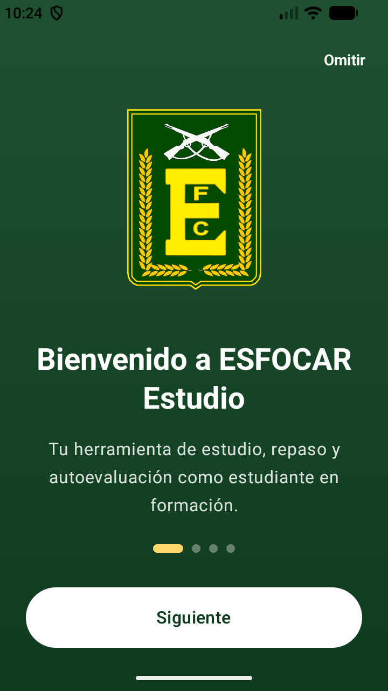 | 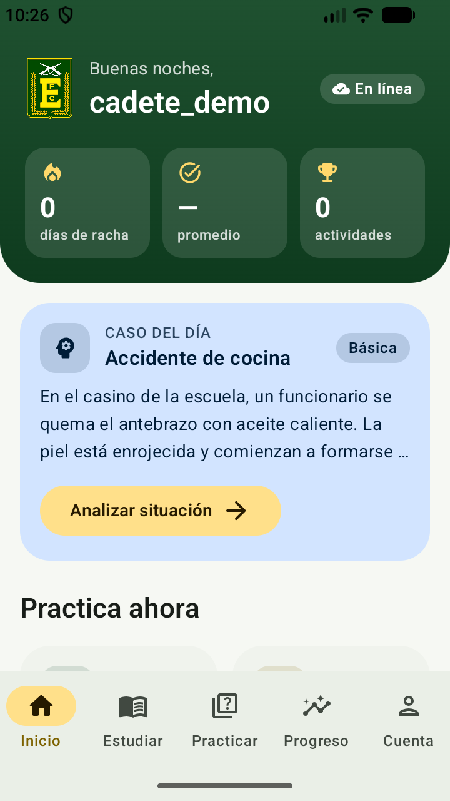 | 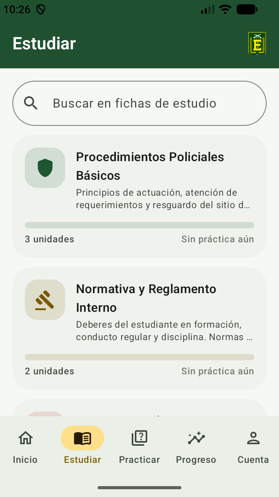 | 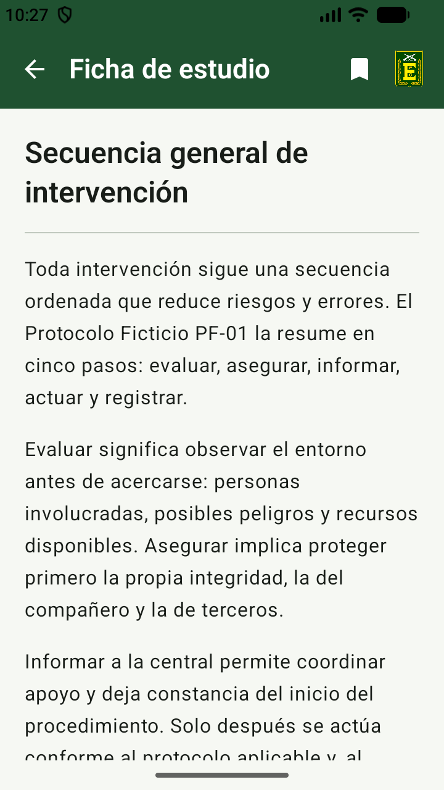 |

| Trivia con retroalimentación | Caso simulado | Progreso | Modo oscuro |
|---|---|---|---|
| 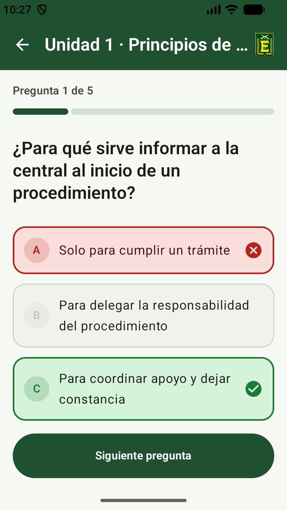 | 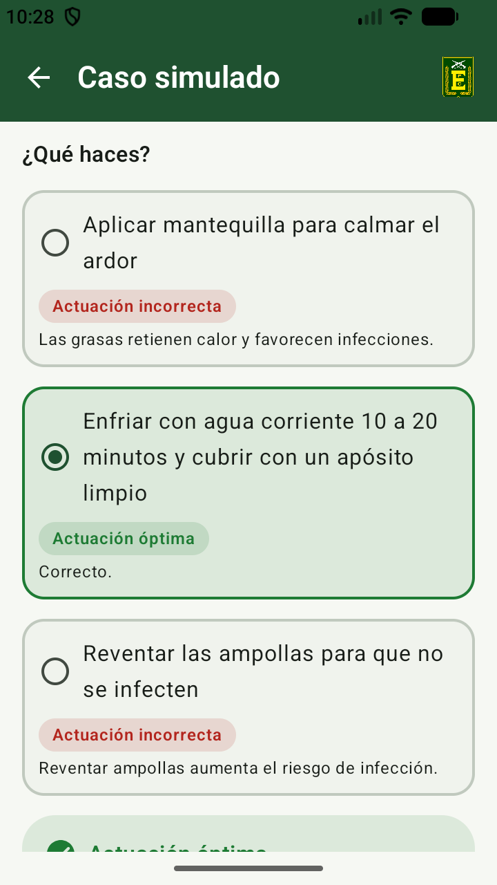 | 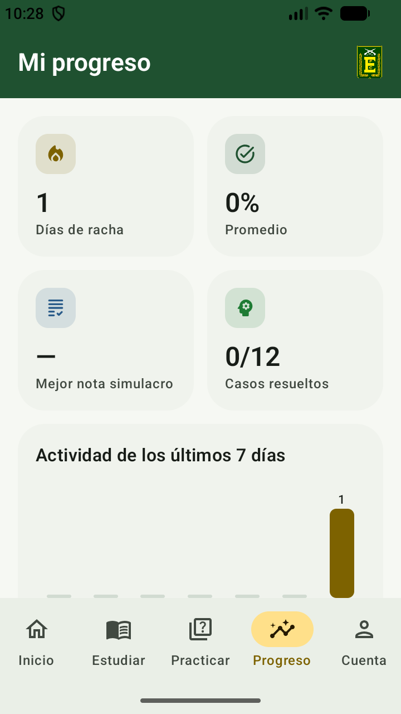 | 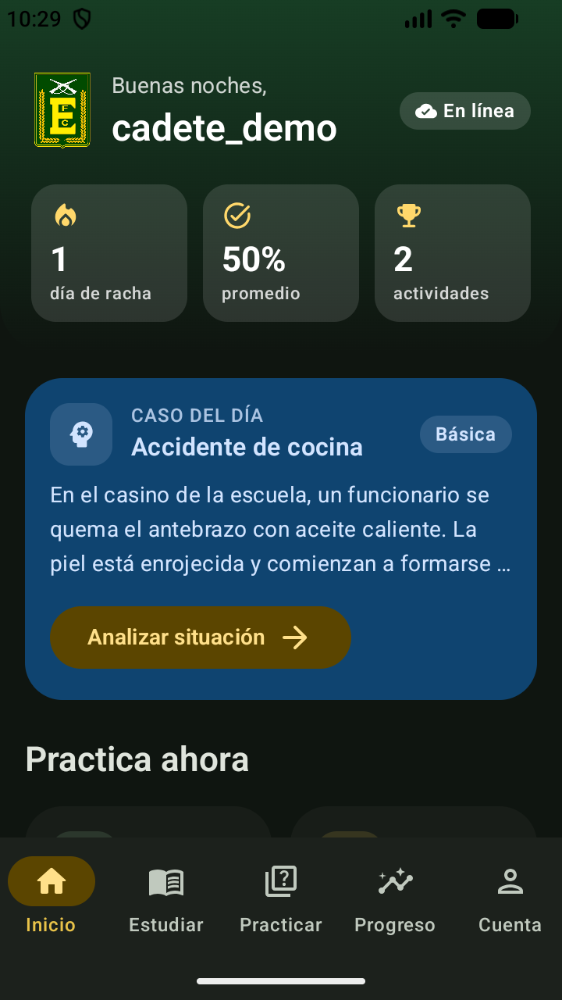 |

| Inicio de sesión | Apuntes sin conexión | Registro como docente | Panel docente |
|---|---|---|---|
| 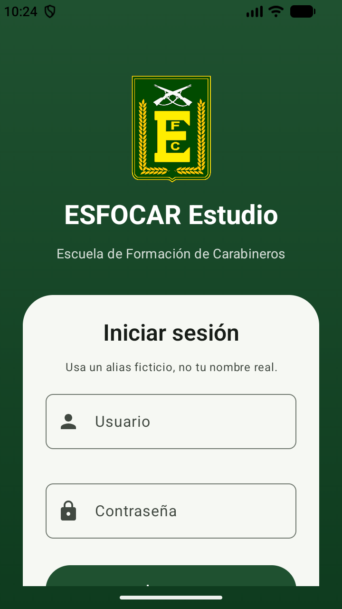 | 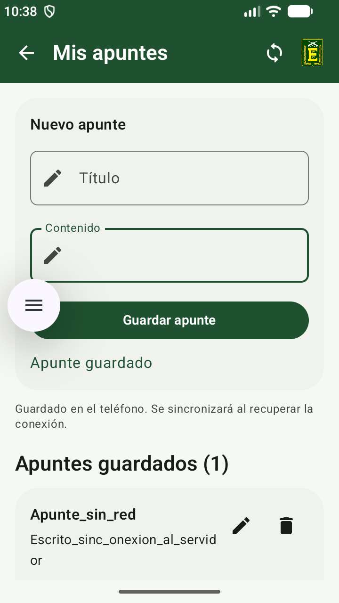 | 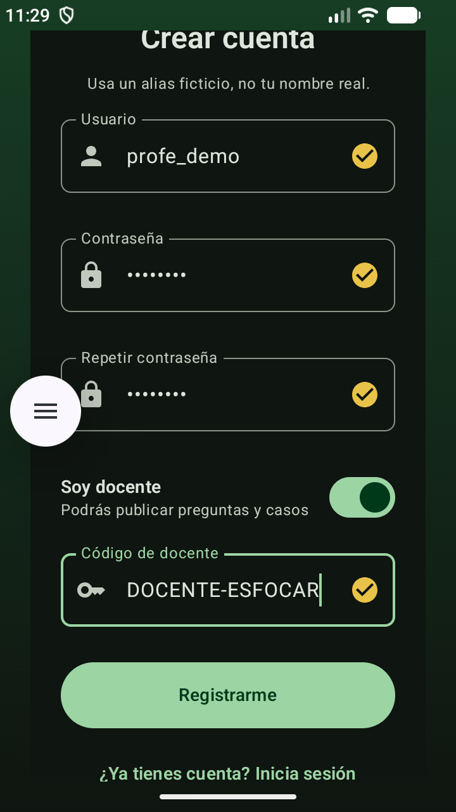 | 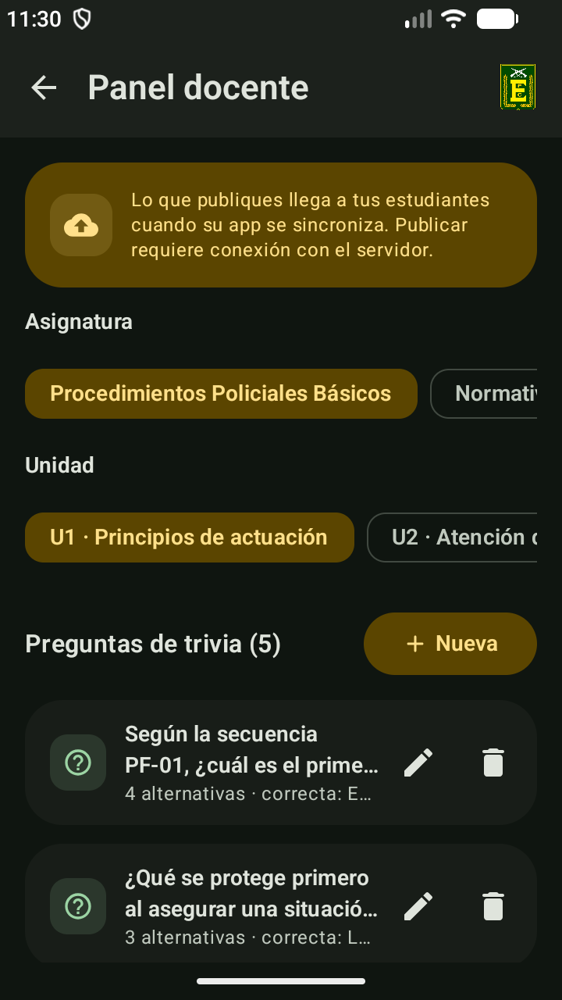 |

## 8. Tecnologías

Kotlin, Jetpack Compose, Material Design 3, Navigation Compose, MVVM, Room, Retrofit + OkHttp + Gson, WorkManager, Splash Screen API, Coroutines y Flow. En el servidor: Spring Boot 3, Spring Data JPA, Bean Validation y H2. Pruebas con JUnit, MockK, MockWebServer, JaCoCo y MockMvc. El APK release se optimiza con R8.

## 9. Trabajo y planificación

- Desarrollo individual, con commits por funcionalidad en ramas `feat/...` integradas por Pull Request.
- Planificación de tareas por hito en Trello (enlace arriba).
