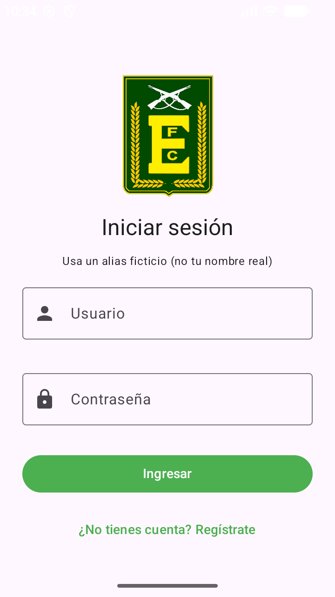
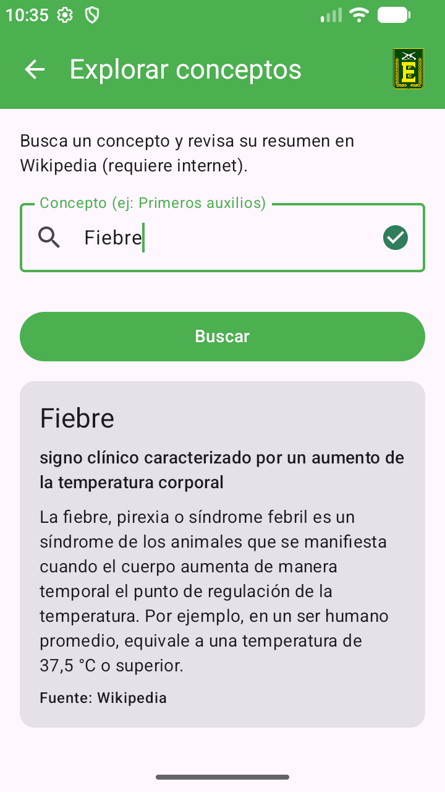
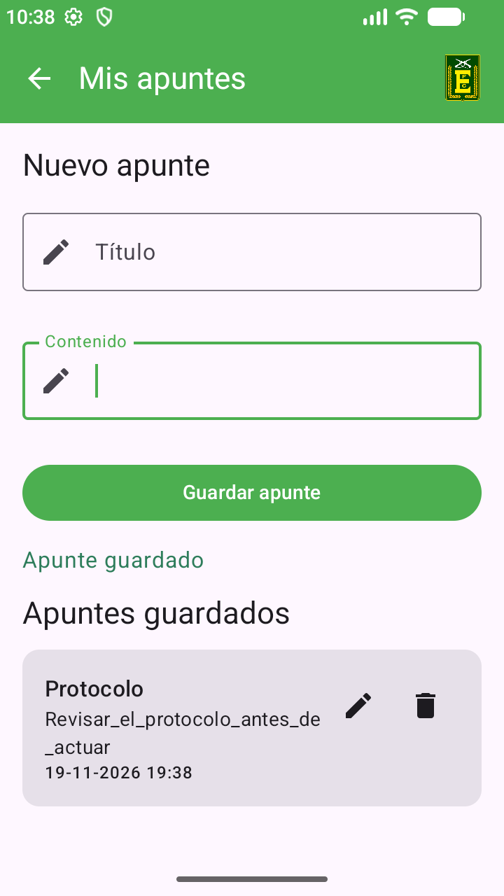

# ESFOCAR – App de Estudio y Autoevaluación

- **Asignatura:** DSY1105 Desarrollo de Aplicaciones Móviles – Evaluación Parcial 4 (Encargo, parejas)
- **Integrantes:** Maximiliano Rodriguez · _[nombre de la pareja]_
- **Tablero Trello:** _[pegar enlace del tablero]_

## 1. Descripción y contexto

Aplicación Android para estudiantes en formación: permite estudiar por asignatura, resolver trivias de autoevaluación con retroalimentación inmediata, guardar apuntes personales y revisar el progreso. Todos los datos son ficticios.

Esta entrega continúa el MVP de la Evaluación Parcial 2 y agrega: **consumo de API externa (Retrofit)**, **dos microservicios propios en Spring Boot con base de datos**, **pruebas unitarias (94 % de cobertura de la lógica)** y **APK release firmado**.

## 2. Funcionalidades

| Funcionalidad | Dónde viven los datos |
|---|---|
| Registro, inicio y cierre de sesión (formularios validados) | Local (Room, clave con hash SHA-256) |
| Trivias con retroalimentación inmediata y puntaje | Local + **se sincroniza** con `ms-resultados` |
| **Apuntes personales: crear, listar, editar y eliminar (CRUD)** | **Microservicio `ms-apuntes`** |
| **Resumen de progreso** (intentos, promedio, mejor resultado) | **Microservicio `ms-resultados`** |
| **Explorar conceptos** (resumen de un artículo) | **API externa: Wikipedia** |
| Carga, visualización y eliminación de documentos PDF/Word | Local (Room + selector del sistema) |
| Historial de actividades, recordatorio con notificación, vibración | Local / recursos nativos |

Si no hay conexión, la app lo informa con un mensaje claro ("Sin conexión con el servidor") y el historial local de trivias y los documentos siguen disponibles.

## 3. Arquitectura

```
┌────────────────────────── App Android (Kotlin + Compose) ──────────────────────────┐
│ ui/  →  viewmodel/  →  data/ (repositorios)  →  Room (local)                         │
│                                              →  Retrofit ─┬─► ms-apuntes    :8081   │
│                                                           ├─► ms-resultados :8082   │
│                                                           └─► Wikipedia (https)     │
└──────────────────────────────────────────────────────────────────────────────────────┘
```

- `app/` – app móvil (MVVM + Repositorio). Los ViewModels reciben sus repositorios por constructor (`viewmodel/Fabrica.kt`, `AppContainer.kt`), lo que permite probarlos con MockK.
- `backend/ms-apuntes` y `backend/ms-resultados` – microservicios Spring Boot 3 (Java 17) con Spring Data JPA y base de datos **H2 en archivo** (persistente, sin instalar nada).
- `release/` – APK firmado. `app/esfocar-release.jks` + `keystore.properties` – llave y configuración de firma.

## 4. Endpoints

### 4.1 Microservicio `ms-apuntes` (puerto 8081)

| Método | Ruta | Descripción | Respuesta |
|---|---|---|---|
| GET | `/api/apuntes?alias={alias}` | Lista los apuntes del usuario | 200 |
| GET | `/api/apuntes/{id}` | Obtiene un apunte | 200 / 404 |
| POST | `/api/apuntes` | Crea un apunte | 201 / 400 |
| PUT | `/api/apuntes/{id}` | Actualiza un apunte | 200 / 400 / 404 |
| DELETE | `/api/apuntes/{id}` | Elimina un apunte | 204 / 404 |

Cuerpo POST/PUT: `{"alias":"cadete_01","titulo":"Protocolo","contenido":"Texto de al menos 10 caracteres"}`.
Validaciones: título 3–40 caracteres, contenido 10–2000, alias obligatorio (máx. 15). Errores: `{"error":"mensaje"}`.

### 4.2 Microservicio `ms-resultados` (puerto 8082)

| Método | Ruta | Descripción | Respuesta |
|---|---|---|---|
| POST | `/api/resultados` | Registra el resultado de una trivia | 201 / 400 |
| GET | `/api/resultados?alias={alias}` | Lista los resultados del usuario | 200 |
| GET | `/api/resultados/resumen?alias={alias}` | Intentos, promedio % y mejor % | 200 |
| DELETE | `/api/resultados/{id}` | Elimina un resultado | 204 / 404 |

Cuerpo POST: `{"alias":"cadete_01","actividad":"Trivia rápida","aciertos":2,"total":3}` (aciertos ≤ total).

Consola de la base de datos (H2): `http://localhost:8081/h2-console` y `http://localhost:8082/h2-console`
(JDBC URL `jdbc:h2:file:./data/apuntes-db` o `./data/resultados-db`, usuario `sa`, sin contraseña).

### 4.3 API externa: Wikipedia (consumida con Retrofit)

| Método | URL | Uso en la app |
|---|---|---|
| GET | `https://es.wikipedia.org/api/rest_v1/page/summary/{titulo}` | Pantalla **Explorar conceptos**: muestra título, descripción y resumen |

API pública, sin llave. Si el artículo no existe (404) la app muestra "No se encontró un artículo…". No interfiere con los datos locales ni con los microservicios (solo lectura).

## 5. Pasos para ejecutar

### Requisitos
- Android Studio (incluye JDK 17+ y SDK Android 37) · Internet (Gradle y Wikipedia).
- El `java` del sistema puede ser antiguo: usa el JDK de Android Studio (`<Android Studio>/jbr`) como `JAVA_HOME`.

### Paso 1 – Levantar los microservicios
```bash
cd backend
./gradlew :ms-apuntes:bootRun      # terminal 1 → http://localhost:8081
./gradlew :ms-resultados:bootRun   # terminal 2 → http://localhost:8082
```
(o `./gradlew bootJar` y luego `java -jar ms-apuntes/build/libs/ms-apuntes.jar`).
Las bases de datos se crean solas en `backend/<servicio>/data/` (o en la carpeta desde donde se ejecuta el `.jar`).

### Paso 2 – Ejecutar la app
1. Abrir la carpeta raíz del repositorio con Android Studio y esperar la sincronización de Gradle.
2. **Emulador:** ejecutar (Run). La app usa `10.0.2.2` para llegar a los microservicios del PC.
3. **Teléfono real:** conectar el teléfono a la misma red Wi‑Fi y compilar indicando la IP del PC:
   `./gradlew assembleRelease -PbackendHost=192.168.X.X` (permitir Java en el firewall de Windows).
4. Crear una cuenta (alias ficticio y contraseña de 6+ caracteres con letras y números).
5. En Android 17 (API 37) la app pide el permiso **"Dispositivos cercanos / red local"**: aceptar, es necesario para conectarse a los microservicios.

### Paso 3 – Pruebas unitarias y cobertura
```bash
./gradlew :app:testDebugUnitTest      # 87 pruebas (JUnit + MockK + coroutines-test + MockWebServer)
./gradlew :app:jacocoReporte          # cobertura → app/build/reports/jacoco/jacocoReporte/html/index.html
cd backend && ./gradlew test          # 11 pruebas de los microservicios (MockMvc + H2 en memoria)
```
Resultado medido: **94,4 % de líneas** y 89,3 % de instrucciones sobre la lógica (ViewModels, repositorios, validaciones, capa de red). Se excluyen pantallas Compose y código que depende del sistema Android (notificaciones, vibración, base de datos generada).

### Paso 4 – Generar el APK firmado (release)
```bash
./gradlew :app:assembleRelease
# → app/build/outputs/apk/release/app-release.apk  (copia lista en release/esfocar-release.apk)
```
La firma se configura en `app/build.gradle.kts` (`signingConfigs.release`) leyendo `keystore.properties`.

## 6. APK firmado y llave (.jks)

| Elemento | Ubicación |
|---|---|
| APK firmado | [`release/esfocar-release.apk`](release/esfocar-release.apk) |
| Llave (keystore) | [`app/esfocar-release.jks`](app/esfocar-release.jks) (alias `esfocar`) |
| Configuración de firma | [`keystore.properties`](keystore.properties) y `signingConfigs` en [`app/build.gradle.kts`](app/build.gradle.kts) |
| Verificación (`apksigner`, `keytool`) | [`docs/firma-apk.txt`](docs/firma-apk.txt) |

El APK verifica con esquema de firma v2 (`Verified using v2 scheme: true`), certificado `CN=Esfocar App, OU=DSY1105, O=Duoc UC`, RSA 2048.

> ⚠️ **Solo académico:** la llave y sus contraseñas se versionan porque la rúbrica lo exige. En un proyecto real nunca se suben al repositorio.

### Capturas de la app (APK release en emulador)

| Inicio de sesión | API externa (Wikipedia) | CRUD de apuntes (microservicio) |
|---|---|---|
|  |  |  |

## 7. Estructura del repositorio

```
app/                       App Android
  src/main/.../data/       Room, repositorios y capa de red (data/remote: Retrofit)
  src/main/.../viewmodel/  ViewModels + Fabrica
  src/main/.../ui/         Pantallas Jetpack Compose
  src/test/                Pruebas unitarias
backend/                   Microservicios Spring Boot (ms-apuntes, ms-resultados)
release/                   APK firmado
docs/                      Evidencias (capturas, verificación de firma)
```

## 8. Trabajo en equipo (GitHub y Trello)

- Flujo con ramas `feat/...` y Pull Requests hacia `main`; cada integrante trabaja con su propia cuenta y sus commits quedan visibles en el historial.
- Planificación y distribución de tareas en Trello (enlace arriba).
